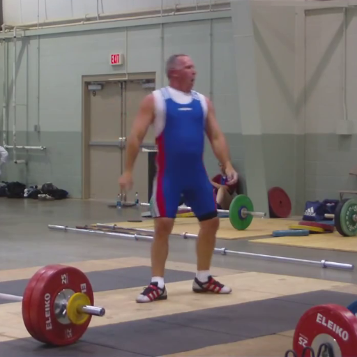
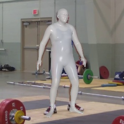
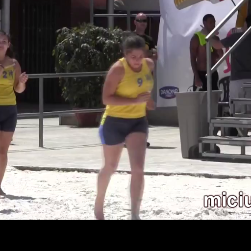
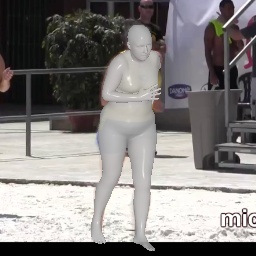
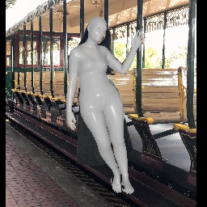
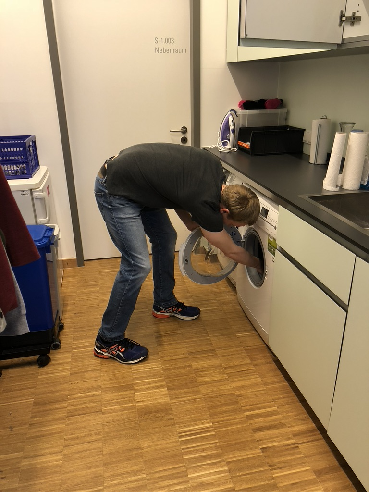
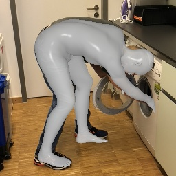

# ShapeBoost: Boosting Human Shape Estimation with Part-based Parameterization and Clothing-preserving Augmentation

The code is adapted from [Original Hybrik](https://github.com/Jeff-sjtu/HybrIK).


## Examples


|  |  |  |  |
| :--------------------: | :----------: | :----------: | :----------: |
|  |  |  |  |


## Installation instructions

``` bash
# 1. Create a conda virtual environment.
conda create -n shapeboost python=3.10 -y
conda activate shapeboost

# 2. Install PyTorch, you may switch to other pytorch and cuda versions if necessary
conda install -c "nvidia/label/cuda-11.8.0" cuda-toolkit
pip install torch==2.4.0 torchvision torchaudio --index-url https://download.pytorch.org/whl/cu118

# Install Pytorch3D
conda install -c iopath iopath
conda install -c bottler nvidiacub
conda install pytorch3d -c pytorch3d

# 4. Install
python setup.py develop
```

## Pretrained models
The pretrained model is available on [Models](https://sjtueducn-my.sharepoint.com/:u:/g/personal/biansiyuan_sjtu_edu_cn/EdIPorN1O0hOqb4T0N68bakBLL_nz41EACPQGKYtecokIg?e=NszFHf).

The extra files are available at [here](https://sjtueducn-my.sharepoint.com/:u:/g/personal/biansiyuan_sjtu_edu_cn/EQpXmNG5-65HuqwbkooKd7sBTDzbCF7-elIBsCktz2Q_Mg?e=PGfvLX) and [here](https://drive.google.com/drive/folders/1I1Amqzn1eqV-PFIbD5q3_qzyZs3zCX9C?usp=drive_link).


## Code Structure
```
ShapeBoost/
├── shapeboost/               
├── examples/                   
├── extra_files/                 
├── model_files/
│   └── smpl_v1.1.0
│   └── ...
└── ...
```


## Demo
``` bash
./scripts/demo.sh configs/hrw48_cam_2x_sratio_semi_analytical.yaml data/model_14_analytical_finetune.pth
```


## Train from scratch

``` bash
./scripts/train_smpl_shape_ddp.sh train_shapeboost configs/hrw48_cam_2x_sratio_semi_analytical.yaml
```

## Evaluation
``` bash
./scripts/validate_smpl_shape_ddp.sh --cfg configs/NIKI_twistswing.yaml --ckpt {CKPT}
```
